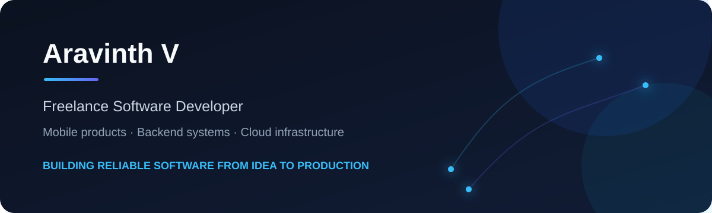

  

  
  
  
  

## About me

I’m **Aravinth V**, a freelance software developer from Tamil Nadu, India. I help founders, teams, and businesses turn product ideas into dependable software.

My work covers the full path from architecture to production: mobile applications, backend APIs, realtime communication, databases, cloud deployment, SDKs, and developer tooling.

> I build software that is practical to use, straightforward to maintain, and ready to grow.

## Services

| Service | What I can deliver |
| --- | --- |
| **Mobile applications** | Android, Flutter, Kotlin Multiplatform, Jetpack Compose, integrations, and production-ready app architecture |
| **Backend systems** | REST APIs, authentication, authorization, service architecture, dashboards, and third-party integrations |
| **Realtime features** | WebSockets, WebRTC, LiveKit, MQTT, messaging, presence, notifications, and event-driven workflows |
| **Data and storage** | PostgreSQL, MongoDB, MySQL, Firebase, Appwrite, Supabase, caching, and data synchronization |
| **Cloud and delivery** | AWS, Google Cloud, Azure, Vercel, Cloudflare, Docker, Git, GitHub, and CI/CD workflows |
| **Developer platforms** | SDKs, API tools, internal platforms, documentation, and developer experience improvements |

## Featured work

### Telestack — backend and realtime platform

My flagship engineering project: a developer platform bringing authentication, storage, secrets, databases, realtime delivery, SDKs, and deployment together.

**Engineering focus:** Go services, TypeScript APIs, PostgreSQL, MongoDB, NATS JetStream, Centrifugo, Docker, encrypted storage, multi-tenant identity, and cross-platform SDK foundations.

**Explore:** [telestack.dev](https://telestack.dev)

### Eziy Attendance Master — Android application

An Android workforce application built with Kotlin and Jetpack Compose, combining attendance workflows, location-based verification, secure local storage, and MQTT notifications.

[View source code →](https://github.com/codeforgebyaravinth-dev/eziy-attendance_master)

### Telestack RTC — realtime collaboration

A WebRTC project exploring peer-to-peer communication, connection diagnostics, direct file transfer, and browser collaboration features.

[View source code →](https://github.com/codeforgebyaravinth-dev/TelestackRTC_demo)

### Telestack RealtimeDB — synchronization research

Research and technical documentation focused on realtime data synchronization, edge-native storage, and backend architecture.

[View source code →](https://github.com/codeforgebyaravinth-dev/telestack-realtime-db-FYP)

### Telestack API Studio and Gateway

Developer tooling and TypeScript gateway work for API development, service integration, and unified backend access.

[API Studio](https://github.com/codeforgebyaravinth-dev/telestack-api-studio) · [Gateway](https://github.com/codeforgebyaravinth-dev/telestack-gateway)

## Technical capabilities

### Mobile and application development

### Languages and backend

### Data, realtime, and infrastructure

### Cloud and delivery

## How I work

1. **Understand the goal** — clarify the users, business outcome, scope, and constraints.
2. **Design the solution** — choose the architecture, data model, integrations, and delivery plan.
3. **Build in milestones** — deliver a usable foundation early and keep progress visible.
4. **Validate and harden** — test important paths, improve reliability, and address security concerns.
5. **Deploy and hand over** — document the system and make future maintenance straightforward.

## GitHub activity

  
  
  

## Let’s work together

If you need a mobile application, backend service, realtime feature, database integration, or cloud deployment, I’m available for freelance work and technical collaborations.

  

  Freelance Software Developer · Tamil Nadu, India

